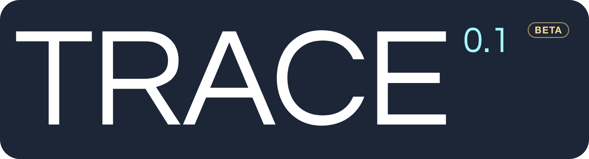
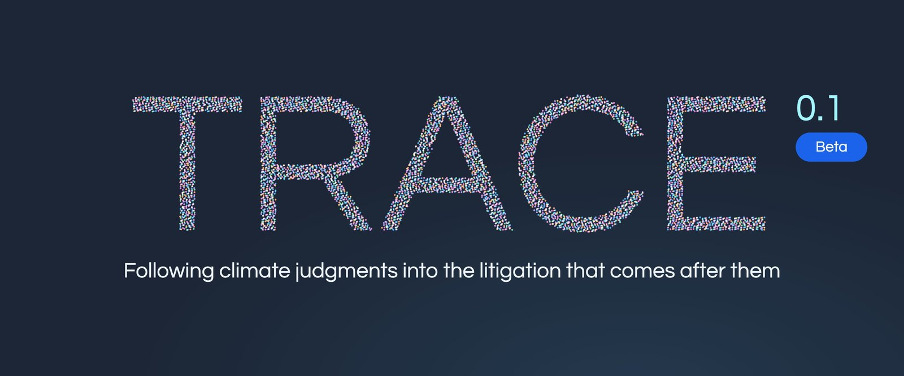
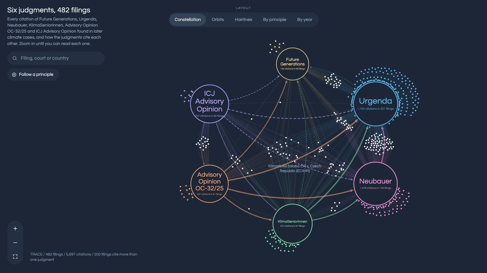
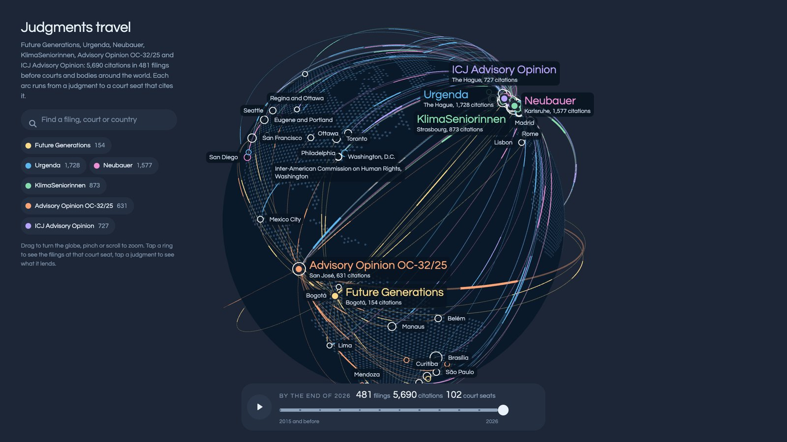
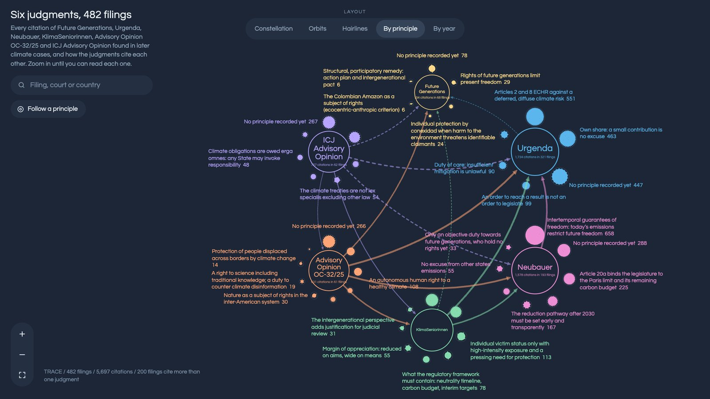

<p align="center">
  <picture>
    <source media="(prefers-color-scheme: dark)" srcset="assets/trace-lockup-dark.png">
    
  </picture>
</p>

<h3 align="center">Traceable Reception and Attribution in Climate-law Evidence</h3>

<p align="center">Following climate judgments into the litigation that comes after them.</p>

<p align="center">
  <a href="LICENSE"></a>
  
  <a href="#how-to-verify"></a>
  <a href="https://github.com/astral-sh/ruff"></a>
</p>

<p align="center"><sub>DOI reserved: 10.5281/zenodo.23082522 (active on publication)</sub></p>

> **Beta.** TRACE 0.1 is a first release. Every proposal it makes is checked by the CLIMPACT research team, and the
> figures it publishes are provisional until the rows judged without machine proposals have a base (see [Limits](#limits)).

For a climate judgment (the *cited case*), TRACE finds every later filing that cites it, in the Climate Litigation
Database, and records for each citation what the citing text does with it: which principles of the judgment it takes
up, and on which nearby pages the argument continues. Six cited cases so far: Urgenda, Neubauer, Future Generations,
KlimaSeniorinnen, the ICJ climate advisory opinion and the Inter-American Court advisory opinion OC-32/25.

Every step leaves a **version code** (`L05`, `R11`, `T01`...) on what it proposes. The codes, with the exact models,
instructions, settings, data and code of each version, are in [`versioni/registro.json`](versioni/registro.json): the
registry is the single source, and where this page differs from it the registry is right.

<p align="center"></p>

## Index

The pipeline step by step: what each step does, the class of the maintained package that does it, the scripts that did
it for the TRACE 0.1 data, and the versions in the registry.

| Step | What it does | `tracepipe` | `legacy/tools` | Versions |
|---|---|---|---|---|
| 1. Corpus | Turns each filing of the Climate Litigation Database into page-marked text, OCRs the unreadable pages and builds the page index the search runs on. | `corpus`: `IndicePagine`, `Documento`, `Pagina`, `PosizioniDopoOcr` | [`001`](legacy/tools/001_build_markdown.py) to [`010`](legacy/tools/010_indice_pagine.py) | **D01** Documents: Climate Litigation Database, public API snapshot<br>**D02** Documents: D01 with OCR text of unreadable pages<br>**D03** Documents: D02 with Markdown for 277 filings of the 19/09/2026 update |
| 2. Cited case | Describes each judgment: the forms of its name, its principles (the *probes*), and a map from its paragraphs to its principles. | `caso`: `CasoCitato`, `SerieSonde`, `MappaParagrafi`; `config`: `Config` | [`011`](legacy/tools/011_sonde.py) to [`015`](legacy/tools/015_formulazioni_provenienza.py) | **P01** Probes of Urgenda<br>**P05** Probes of Neubauer and Future Generations, second set corrected (second round)<br>**P06** Probes of KlimaSeniorinnen<br>**P08** Probes of IACtHR advisory opinion OC-32/25<br>**P09** Probes of the ICJ climate advisory opinion, 1.5°C probe rewritten<br>**R04** Paragraph map, reviewed<br>**R07** Paragraph map with probes P05<br>**R09** Paragraph maps of the three new cases; Spanish and Portuguese paragraph references |
| 3. Name search | Looks for the name of the case in every page, in all its forms (names, ECLI and docket numbers, translations, other scripts, OCR errors), with no AI. Each hit becomes a citation with a permanent code such as `URG-0146`. | `ricerca`: `RicercaPerNome`, `UnioneRighe`; `dimensioni`: `PosizioneNelPdf` | [`016`](legacy/tools/016_cerca.py) to [`022`](legacy/tools/022_coda_uptakes.py); S05 in [`versioni/S05`](versioni/S05) | **S01** Name search, first version<br>**S02** Name search, corrected<br>**S03** Name search on OCR text, more Japanese and Korean forms<br>**S05** Name search on normalised text, with readmitted and new forms (in use) |
| 4. Type of citation | The external reader (DeepSeek V4 Flash) reads each citation in context: is it really the judgment, what the citation does (chain mention, descriptive, substantive, distinguishing, critical), who speaks. | `lettori`: `LettoreTipo`; `istruzioni`; `deepseek`: `ClienteDeepSeek`; `letture`: `Lettura` | [`023`](legacy/tools/023_giudica_llm.py) to [`025`](legacy/tools/025_carica_lessicali.py) | **L02** Citation reading, Urgenda<br>**L03** Citation reading, every case except Urgenda |
| 5. Surrounding pages | TRACE-Reranker scores the pages up to ten before and ten after the citation against each principle; a fixed rule picks the pages worth reading. | `pagine_attorno`: `Punteggi`, `SceltaPagineAttorno` | [`026`](legacy/tools/026_prepara_training.py) to [`029`](legacy/tools/029_coppie_ocr.py), [`031`](legacy/tools/031_leggi_ripresa.py); R10 in [`versioni/R10`](versioni/R10) | **T01** TRACE-Reranker 0.1<br>**R08** Choice of the nearby pages, over the full window for every case<br>**R10** Choice of the surrounding pages: 0.5 at every distance within 10 pages, no cap |
| 6. Uptake reading | The external reader reads the citation with the chosen pages: which principles it takes up, which pages continue the argument, the quotations and the sentence the citation supports. Brakes in the code reject quotations not found on the page. | `lettori`: `LettorePrincipi`, `LettorePagineAttorno`; `freni`: `Freni` | [`030`](legacy/tools/030_prepara_l05.py) to [`034`](legacy/tools/034_freni.py) | **L04** Uptake reading, first version: the principles<br>**L05** Uptake reading with the case dossier: surrounding pages, quotes, supported sentence<br>**L07** Surrounding pages reread on the proposed principles |
| 7. Composition | Fixed rules turn the readings into the proposals shown to the team, only on rows nobody has judged. From 2 October each row is read five times and every field goes by majority vote. | `composizione`: `Composizione`, `ComposizioneMaggioranza`; `maggioranza`; `caricatori`: `CaricatoreTipo`, `CaricatoreRipresa`; `banca`: `BancaDati` | [`025`](legacy/tools/025_carica_lessicali.py), [`035`](legacy/tools/035_carica_ripresa.py); R11 in [`versioni/R11`](versioni/R11) | **R05** Rules that put the proposals together, with the brake for Asian scripts<br>**R11** Proposals by majority vote of five readings (decided 2 October 2026, being applied) |
| 8. Checks | After every load: does every row have everything it must have, and was every page of the window scored. | `controlli`: `ControlloCompletezza`, `ControlloFinestra` | [`036`](legacy/tools/036_controllo_completezza.py) to [`039`](legacy/tools/039_freni_prova.py) | |
| 9. People | Researchers confirm or correct every citation on the CLIMPACT platform; one row in five is shown without any machine proposal, to measure the machine. | (the platform) | [`040`](legacy/tools/040_salva_giudizi.py) | Codebook 0.4-pilot ([`codebook/`](codebook)) |
| 10. Uptake without the name | Experiment: a semantic search for filings that take up the reasoning without naming the judgment. Paused; nothing from it is on the platform. | | [`041`](legacy/tools/041_distilla.py) to [`043`](legacy/tools/043_unisci_candidati.py) | **S04** Semantic search without the name, redone with the supported sentences<br>**L06** Uptake reading, test: principle decided on the whole passage<br>**L09** Uptake reading without the name: takes up the reasoning, from another source, or same topic only |
| 11. Measures | Probe tests and the stability of the external reader. | | [`044`](legacy/tools/044_prova_sonde_reranker.py) to [`047`](legacy/tools/047_stabilita_deepseek.py) | |
| 12. Models | Training of the project's own models (the scripts are in the history section). | | [`065`](legacy/tools/065_addestra_categoria.py) to [`069`](legacy/tools/069_addestra_riordino.py); history to [`118`](legacy/tools/118_sezioni_llm.py) | **T01** TRACE-Reranker 0.1<br>**T02** TRACE-Reader v0<br>**T03** TRACE-Reader v1 |
| 13. Registry and journal | The registry of versions, the results, the operations journal of every run. | `giornale`: `Giornale` | [`048`](legacy/tools/048_registro_versioni.py) to [`055`](legacy/tools/055_pubblica_repo.py) | all: [`versioni/registro.json`](versioni/registro.json) |
| 14. Cycles | The automatic chains that run the steps in order, resume after a crash and check every copy to and from the GPU cluster. | `orchestratore`: `Orchestratore`, `CicloVuote`; `cli` (the `trace` command) | [`056`](legacy/tools/056_ciclo_casi_nuovi.sh) to [`064`](legacy/tools/064_carica_blocco.py) | |

Model cards for T01, T02 and T03: [`MODEL-CARDS.md`](MODEL-CARDS.md). The reading order of all 118 legacy scripts:
[`legacy/tools/LEGGIMI.md`](legacy/tools/LEGGIMI.md).

## Install

```
git clone https://github.com/climpact-project/trace.git
cd trace
python -m venv .venv && source .venv/bin/activate
pip install -e ".[dev]"
pytest
```

Python 3.11 or later. The only runtime dependency is PyYAML; `.[deepseek]` adds the OpenAI client for the readers and
`.[firestore]` the platform database client.

## Quick start

The `trace` command runs one step at a time. **Nothing is written to the platform without `--scrivi`**: without it every
command is a dry run that prints what it would do (the readers write their own reading files and never touch the
platform).

```
trace --help
export TRACE_RADICE=/path/to/corpus          # the folder with markdown/, index/, cited-cases/, codebook/
trace cerca --caso urgenda --solo-lessicale  # name search: the candidate citations, as a CSV
trace unisci --caso urgenda                  # dry run: the citations it would merge or add
trace prepara pagine-attorno --caso urgenda --regola R10 --etichetta prova
trace leggi pagine-attorno --caso urgenda --letture 5 --etichetta prova   # needs a DeepSeek server
trace carica ripresa --caso urgenda --composizione R11 --etichetta prova  # dry run of the composition
trace controlla completezza
```

Comments, command options and messages are in Italian, the team's working language; the vocabulary is explained in the
docstring of each module.

## What you need to run it

- **The corpus texts.** The filings are not redistributed here (terms of the Sabin Center for Climate Change Law). They
  are public on the Climate Litigation Database; [`legacy/tools/001_build_markdown.py`](legacy/tools/001_build_markdown.py)
  turns the downloaded PDFs into the page-marked text the pipeline reads, and the public corpus index (see
  [Data](#data)) lists every document with its source URL and the SHA-256 of the PDF used, with a script that rebuilds
  and verifies the page text.
- **The external reader.** DeepSeek V4 Flash, served with vLLM; the weights come from the official DeepSeek release
  (MIT licence). The readers call it through an OpenAI-compatible endpoint (`--base-url`, key in `chat/chiave`).
- **TRACE-Reranker (T01).** A LoRA adapter on Qwen3-Reranker-4B; the adapter is to be published on Zenodo with the
  release.
- **The platform database**, only to load proposals (`--scrivi`): any implementation of `tracepipe.banca.BancaDati`.
  The tests use the in-memory one.

## What is not in this repository

| What | Why | Where to get it |
|---|---|---|
| Texts of the filings | Sabin Center terms; party filings can carry their authors' rights | The Climate Litigation Database; the corpus index, tiers 1 to 3 below |
| Model weights (T01, T02, T03) | Size | Zenodo, to be published with the release |
| DeepSeek V4 Flash weights | Third-party model | The official DeepSeek release (MIT) |
| Readings, scores, human judgments | Platform data with filing text in them | Released as data on Zenodo, to be published with the release |
| The reference harness sample (`prove/campione`) | Filing texts and platform data | Not redistributed; described under [How to verify](#how-to-verify) |
| Keys and credentials | | Never in the repository |

## Data

The corpus index of TRACE 0.1 (corpus version D03: 577,121 pages of 16,993 documents) is released in three tiers, to
be published with the release:

1. **Public index, no text.** Every page and document with identifiers, character offsets, the SHA-256 of the page
   text, OCR and readability flags, and the position of every citation; plus a script that rebuilds the page text from
   the original PDFs and verifies it page by page. 559,072 of the 559,499 pages whose text comes from the PDF's own
   text layer verify byte for byte.
2. **Public text of public-authority documents.** The page text of the 4,456 documents issued by courts and other
   public authorities (110,013 pages): judgments, decisions, orders. Court decisions and official acts are free of
   copyright.
3. **Full index, on request.** The page index with the text of every page, including party filings and OCR text, for
   verifying TRACE results. Restricted access: write to the project at info@climpact.it. Access is granted for research
   use only, in particular to verify TRACE results; the file must not be redistributed, it is kept securely and deleted
   when the verification is over, and the source is cited: the Climate Litigation Database of the Sabin Center for
   Climate Change Law (Columbia Law School) with Climate Policy Radar, and CLIMPACT TRACE 0.1.

The documents come from the Climate Litigation Database of the Sabin Center for Climate Change Law (Columbia Law
School) with Climate Policy Radar, read through its public API (snapshot of 26 July 2026, update of 19 September 2026).
Data provided by the Sabin Center for Climate Change Law. Platform operated by Climate Policy Radar.

## How to verify

- **Tests.** `pytest` from a fresh clone runs the tests that need no private data; the ones that need the harness
  sample or the live scripts are skipped, each with its reason. On the team's machine, with the private data, the
  whole suite runs (405 tests).
- **Reference harness.** Every class of `tracepipe` reproduces a legacy script. A harness, kept with the private data,
  runs the legacy scripts and the package on a fixed sample (180 rows from the six cases, filing texts included, with
  the database, the external reader and the clock replaced by recorded fakes) and compares every output file: 298 of
  298 files and 67 of 67 journals equal, in compatibility mode. The sample is not redistributed because it contains
  filing texts.
- **Registry fingerprints.** Every version lists the SHA-256 of the instructions and code it ran with, and keeps a frozen
  copy in `versioni/`:

  ```
  python scripts/verify_registry.py
  ```

## What TRACE shows

<table>
  <tr>
    <td width="33%"></td>
    <td width="33%"></td>
    <td width="33%"></td>
  </tr>
  <tr>
    <td><sub>Six judgments and the 482 filings that cite them, and how the judgments cite each other.</sub></td>
    <td><sub>Judgments travel: every arc runs from a judgment to a court seat that cites it.</sub></td>
    <td><sub>By principle: the citations grouped by the principle of the judgment they take up.</sub></td>
  </tr>
</table>

## Repository

```
tracepipe/      the pipeline package (maintained)
tests/          the tests of the package
legacy/tools/   the 118 scripts that produced the TRACE 0.1 data, in reading order
versioni/       the registry of versions and the frozen copy of every version's instructions and code
cited-cases/    for each cited case: the case file, the probe series, the dossier, the paragraph map
codebook/       the coding categories and the rules for hard cases (0.4-pilot)
scripts/        verify_registry.py
assets/         images of this page
```

## Limits

- **No agreement figure published so far is a blind measure.** The figures the platform computes come from judgments
  given with the machine's proposals visible: they say how often people changed a proposal, not how often the machine
  is right. Rows judged without any proposal are being judged now; a blind figure will be published when that sample
  has a base.
- The models of 0.1 were trained on labels that are being corrected (T01) or on the external reader's readings (T02,
  T03), and on one cited judgment, Urgenda.
- The human reference rows used to compare readings are not frozen; those comparisons are provisional.

## How to cite

> Naglieri, G., Buono, E., Garofalo, C., Saracino, C., Dell'Atti, L. (2026). *CLIMPACT TRACE 0.1: Traceable Reception
> and Attribution in Climate-law Evidence.* CLIMPACT, University of Bari. Zenodo. DOI reserved: 10.5281/zenodo.23082522
> (active on publication).

Machine-readable citation: [`CITATION.cff`](CITATION.cff).

## Licence

Code: MIT ([`LICENSE`](LICENSE)). Case files, codebook and registry: CC BY 4.0.

## Credits

TRACE is developed by **CLIMPACT** at the University of Bari Aldo Moro. The models were trained and the readings
computed on the **ReCaS-Bari** data centre of INFN and the University of Bari.

<table>
  <tr>
    <td align="center"><sub>Developed at</sub></td>
    <td align="center"><sub>Computed on</sub></td>
  </tr>
  <tr>
    <td align="center">
      <picture>
        <source media="(prefers-color-scheme: dark)" srcset="assets/logos/climpact-wordmark-white.svg">
        
      </picture>
      &nbsp;&nbsp;&nbsp;
      <picture>
        <source media="(prefers-color-scheme: dark)" srcset="assets/logos/uniba-white.png">
        
      </picture>
    </td>
    <td align="center">
      <picture>
        <source media="(prefers-color-scheme: dark)" srcset="assets/logos/computed-on-dark.png">
        
      </picture>
    </td>
  </tr>
</table>
