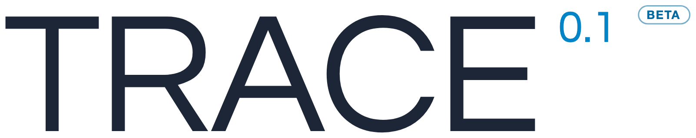
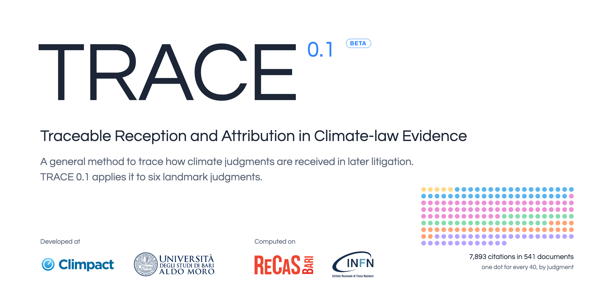
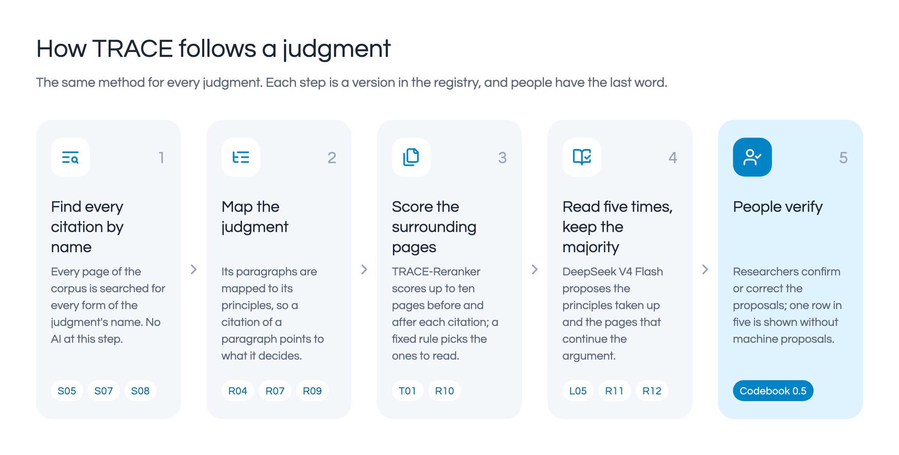
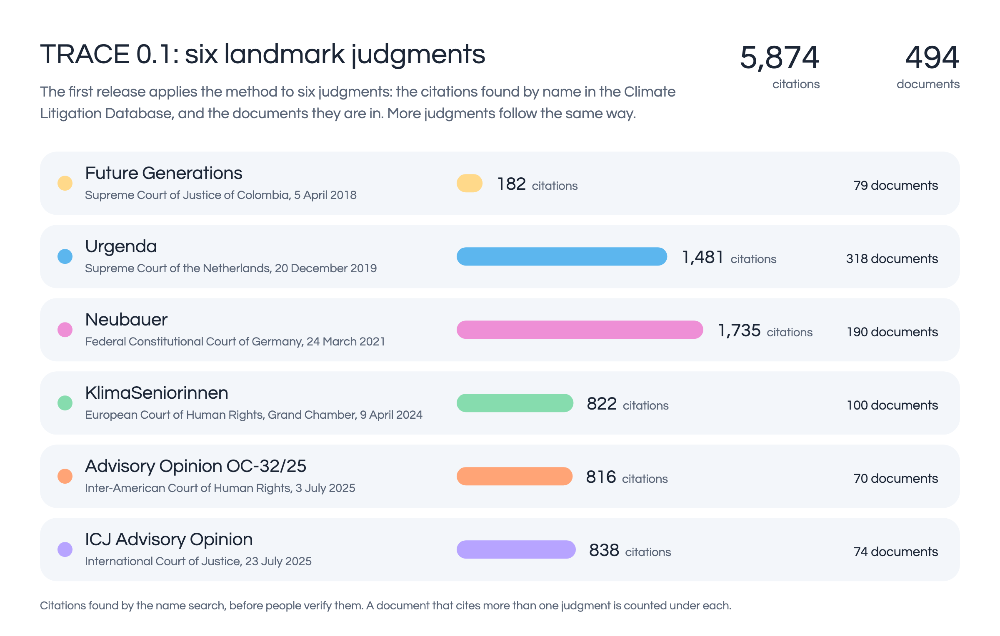
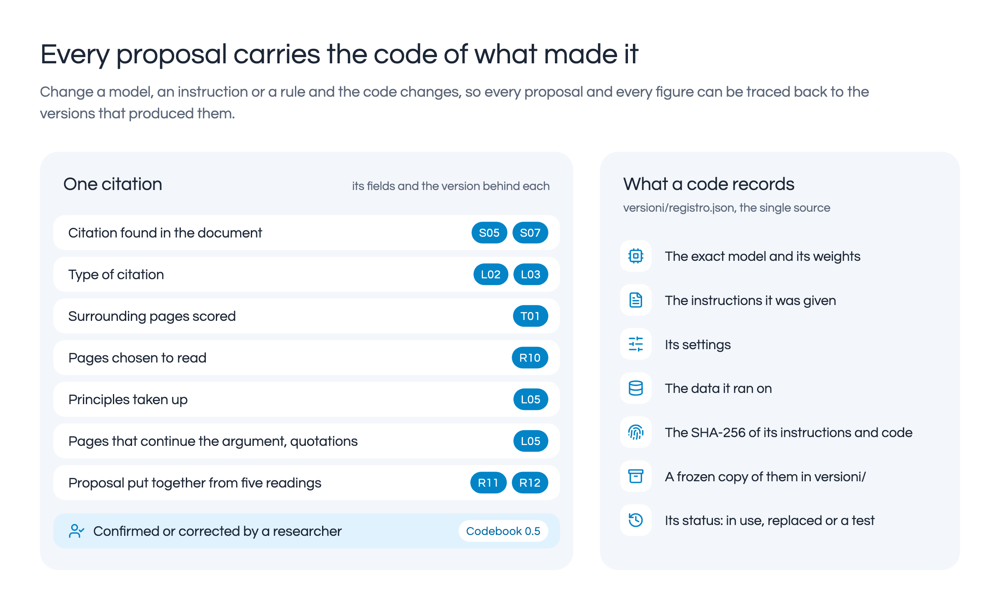

<p align="center">
  <picture>
    <source media="(prefers-color-scheme: dark)" srcset="assets/trace-lockup-dark.png">
    
  </picture>
</p>

<h3 align="center">Traceable Reception and Attribution in Climate-law Evidence</h3>

<p align="center">Following climate judgments into the litigation that comes after them.</p>

<p align="center">
  <a href="LICENSE"></a>
  
  <a href="#how-to-verify"></a>
  <a href="https://github.com/astral-sh/ruff"></a>
</p>

<p align="center"><sub>DOI reserved: 10.5281/zenodo.23275400 (active on publication)</sub></p>

**What TRACE is for.** TRACE brings to the surface what no research team could find by reading alone: every citation of the climate judgments it follows, across hundreds of later filings and thousands of pages, each with the sentence that carries it and a proposal of what it does, and hands it to the people who decide. People stay at its centre. Its strength is the pipeline. It stacks many layers on top of one another: name searches, paragraph maps, rules, five independent readings, models trained on the team's judgments, and a version code on every step. Each layer is measured, and every proposal can be traced back to the exact words on the page and the exact version that produced it. That order is what made these results possible with just over 400 citations judged by people. This first release is a beta, and a starting point, not a ceiling. Every new human judgment enters a pipeline that is already ordered and traceable to the smallest piece, and becomes clean training data, so each one makes the next model better informed. TRACE 0.2 will measure how far that takes it.

> **Beta.** TRACE 0.1 is a first release. Every proposal it makes is open to checking by the CLIMPACT research team: at
> release 414 of the 7,893 citations are verified, and the others are machine proposals, not findings. The
> figures it publishes are provisional until the rows judged without machine proposals have a base (see [Limits](#limits)).
> The proposals come from **DeepSeek V4 Flash** (DeepSeek-V4-Flash-0731, MIT licence), a large language model with open
> weights that we run with vLLM on NVIDIA H100 GPUs at ReCaS-Bari (INFN and University of Bari): it reads each
> citation five times and the majority decides (R11, Proposals by majority vote of five readings: a principle with 3 of 5; R12, a principle
> needs two votes, and the rules built on it, R13 to R16, propose a principle with 2 of 5 and flag the row as uncertain;
> R15 and R16 also take the supporting sentence and the evidence from the text of the filing). The codes L are its
> readings.

For a climate judgment (the *cited case*), TRACE finds every later filing that cites it, in the Climate Litigation
Database, and records for each citation what the citing text does with it: which principles of the judgment it takes
up, and on which nearby pages the argument continues. TRACE works for any judgment that has a case file; TRACE 0.1,
the first release, follows these judgments and advisory opinions: Urgenda, Neubauer, Future Generations, KlimaSeniorinnen, the ICJ climate advisory
opinion and the Inter-American Court advisory opinion OC-32/25. It is built to grow beyond judgments, to laws, policies
and the other sources through which climate-law reasoning travels (see [What comes next](#what-comes-next)).

Every step leaves a **version code** (such as `L05`, `R11`, `T01`) on what it proposes. The codes, with the exact models,
instructions, settings, data and code of each version, are in [`versioni/registro.json`](versioni/registro.json): the
registry is the single source, and where this page differs from it the registry is right.

<p align="center"></p>

## Index

The pipeline step by step: what each step does, the class of the maintained package that does it, the scripts that did
it for the TRACE 0.1 data, and the versions in the registry.

| Step | `tracepipe` | `legacy/tools` | Versions |
|---|---|---|---|
| **1. Corpus**<br>Turns each filing into page-marked text, OCRs unreadable pages, builds the page index. | `corpus`: IndicePagine, Documento, Pagina, PosizioniDopoOcr | [`001`](legacy/tools/001_build_markdown.py) to [`010`](legacy/tools/010_indice_pagine.py) | **D01** Documents: Climate Litigation Database, public API snapshot<br>**D02** Documents: D01 with OCR text of unreadable pages<br>**D03** Documents: D02 with Markdown for 277 filings of the 19/09/2026 update |
| **2. Cited case**<br>The forms of the name of each judgment, its principles (the *probes*), the map from its paragraphs to its principles. | `caso`: CasoCitato, SerieSonde, MappaParagrafi<br>`config`: Config | [`011`](legacy/tools/011_sonde.py) to [`015`](legacy/tools/015_formulazioni_provenienza.py) | **P01** Probes of Urgenda<br>**P05** Probes of Neubauer and Future Generations, second set corrected (second round)<br>**P06** Probes of KlimaSeniorinnen<br>**P08** Probes of IACtHR advisory opinion OC-32/25<br>**P09** Probes of the ICJ climate advisory opinion, 1.5°C probe rewritten<br>**R04** Paragraph map, reviewed<br>**R07** Paragraph map with probes P05<br>**R09** Paragraph maps of the three new cases; Spanish and Portuguese paragraph references |
| **3. Name search**<br>Finds the name of the case in every page, in all its forms, with no AI. Each hit becomes a citation with a permanent code (`URG-0146`). | `ricerca`: RicercaPerNome, UnioneRighe<br>`dimensioni`: PosizioneNelPdf | [`016`](legacy/tools/016_cerca.py) to [`022`](legacy/tools/022_coda_uptakes.py); S05 in [`versioni/S05`](versioni/S05) | **S01** Name search, first version<br>**S02** Name search, corrected<br>**S03** Name search on OCR text, more Japanese and Korean forms<br>**S05** Name search on normalised text, with readmitted and new forms (in use)<br>**S06** S05 copies in another case, recovered (in use)<br>**S07** Name search: footnote-aware grouping, descriptive references, same-page dedup (in use) |
| **4. Citations counted once**<br>The same citation can reach the database twice: in the body text and again in the footnote that the same sentence calls, in two translations of one filing, or as a surrounding page that holds a citation of its own. Rules mark one of the two; nothing is deleted. | `unione_c03`: UnioneC03, GeneratoreCoppie, CoppieRivedute<br>`pagine_gia_citate`: ApplicaC07, RiconoscitorePagine<br>`copia_prima`: CopiaPrima | (came after the legacy scripts) | **C03** Body text and footnote, and translations of the same filing, counted once (applied 5 October 2026)<br>**C07** Surrounding page that is already a citation of its own: also cited separately (applied 5 October 2026) |
| **5. Close pairs**<br>Two references to the same case in the same filing, less than 5,000 characters apart, are read together: one citation or two? Applied on 8 October 2026. | `coppia`: Coppia<br>`coppie_vicine`: CoppieVicine, Taratura<br>`lettura_coppia`: DomandaL13, LettoreCoppie<br>`decisione_coppie`: Decisore<br>`carica_s08`: CaricaS08<br>`prova_intera`: FreniProvaIntera | (came after the legacy scripts) | **S08** Close pairs: two references to the same case in the same filing, read together (applied on 8 October 2026)<br>**L13** Reading of a close pair: one citation or two (applied with S08) |
| **6. Type of citation**<br>DeepSeek V4 Flash, a large language model, says what each citation does: chain mention, descriptive, substantive, distinguishing, critical. | `lettori`: LettoreTipo<br>`istruzioni`<br>`deepseek`: ClienteDeepSeek<br>`letture`: Lettura | [`023`](legacy/tools/023_giudica_llm.py) to [`025`](legacy/tools/025_carica_lessicali.py) | **L02** Citation reading, Urgenda<br>**L03** Citation reading, every case except Urgenda |
| **7. Surrounding pages**<br>TRACE-Reranker scores the pages up to ten before and after the citation; a fixed rule picks the ones to read. T04, a reasoning reranker trained by the project, is published as a new model (see below); T01 stays the one in use. | `pagine_attorno`: Punteggi, SceltaPagineAttorno; `punteggio_t01` (`trace punteggi`) | [`026`](legacy/tools/026_prepara_training.py) to [`029`](legacy/tools/029_coppie_ocr.py), [`031`](legacy/tools/031_leggi_ripresa.py); R10 in [`versioni/R10`](versioni/R10) | **T01** TRACE-Reranker 0.1<br>**R08** Choice of the nearby pages, over the full window for every case<br>**R10** Choice of the surrounding pages: 0.5 at every distance within 10 pages, no cap |
| **8. Uptake reading**<br>DeepSeek V4 Flash proposes the principles taken up, the pages that continue the argument and the quotations; brakes in the code reject quotations not on the page. | `lettori`: LettorePrincipi, LettorePagineAttorno<br>`freni`: Freni | [`030`](legacy/tools/030_prepara_l05.py) to [`034`](legacy/tools/034_freni.py) | **L04** Uptake reading, first version: the principles<br>**L05** Uptake reading with the case dossier: surrounding pages, quotes, supported sentence<br>**L07** Surrounding pages reread on the proposed principles |
| **9. Composition**<br>Fixed rules turn the readings into proposals, only on rows nobody has judged. From 2 October: five readings per row, majority vote. | `composizione`: Composizione, ComposizioneMaggioranza<br>`maggioranza`<br>`caricatori`: CaricatoreTipo, CaricatoreRipresa<br>`banca`: BancaDati | [`025`](legacy/tools/025_carica_lessicali.py), [`035`](legacy/tools/035_carica_ripresa.py); R11 in [`versioni/R11`](versioni/R11) | **R05** Rules that put the proposals together, with the brake for Asian scripts<br>**R11** Proposals by majority vote of five readings (decided 2 October 2026, in use)<br>**R12** A principle needs at least 2 of 5 readings (in use)<br>**R13** An empty principle list counts as «none» (in use)<br>**R14** Proofs searched in the text of the filing, without system markers (in use)<br>**R15** Supporting sentence extracted from the text, footnote marker to body sentence (in use)<br>**R16** The whole proof must be found in the page, repaired from the text of the filing (in use) |
| **10. Checks**<br>After every load: every row complete, every page of the window scored. | `controlli`: ControlloCompletezza, ControlloFinestra | [`036`](legacy/tools/036_controllo_completezza.py) to [`039`](legacy/tools/039_freni_prova.py) |  |
| **11. People**<br>Researchers confirm or correct every citation; one row in five is shown without machine proposals. | (the platform) | [`040`](legacy/tools/040_salva_giudizi.py) | Codebook 0.5-pilot ([`codebook/`](codebook)) |
| **12. Uptake without the name**<br>Experiment, paused: filings that take up the reasoning without naming the judgment. | (legacy only) | [`041`](legacy/tools/041_distilla.py) to [`043`](legacy/tools/043_unisci_candidati.py) | **S04** Semantic search without the name, redone with the supported sentences<br>**L06** Uptake reading, test: principle decided on the whole passage<br>**L09** Uptake reading without the name: takes up the reasoning, from another source, or same topic only |
| **13. Measures**<br>Probe tests, stability of DeepSeek V4 Flash. | (legacy only) | [`044`](legacy/tools/044_prova_sonde_reranker.py) to [`047`](legacy/tools/047_stabilita_deepseek.py) |  |
| **14. Models**<br>Training of the project's own models. | (legacy only) | [`065`](legacy/tools/065_addestra_categoria.py) to [`069`](legacy/tools/069_addestra_riordino.py); history to [`118`](legacy/tools/118_sezioni_llm.py) | **T01** TRACE-Reranker 0.1<br>**T02** TRACE-Reader v0<br>**T03** TRACE-Reader v1<br>**T04** TRACE-Reranker, reasoning (new model; training script [`tools/addestra_reranker_ragiona.py`](versioni/T04/addestra_reranker_ragiona.py)) |
| **15. Registry and journal**<br>The registry of versions, the results, the journal of every run. | `giornale`: Giornale | [`048`](legacy/tools/048_registro_versioni.py) to [`055`](legacy/tools/055_pubblica_repo.py) | all: [`versioni/registro.json`](versioni/registro.json) |
| **16. Cycles**<br>The automatic chains: steps in order, resume after a crash, checked copies to and from the GPU cluster. | `orchestratore`: Orchestratore, CicloVuote<br>`cli` | [`056`](legacy/tools/056_ciclo_casi_nuovi.sh) to [`064`](legacy/tools/064_carica_blocco.py) |  |

Model cards for T01, T02, T03, T04, the untrained reasoning reranker and L13: [`MODEL-CARDS.md`](MODEL-CARDS.md). The reading order of all 118 legacy scripts:
[`legacy/tools/LEGGIMI.md`](legacy/tools/LEGGIMI.md).

## Applied and on trial (5 and 8 October 2026)

Three steps that count a citation once were **applied** to the platform: C03 and C07 on 5 October 2026, S08 (with
the reading L13) on 8 October 2026. T04 is published as a new model and produced no data of this release.

**Applied**

- **C03, body text and footnote, and translations of the same filing, counted once.** The same citation reached the
  database twice: in the body text and again in the footnote that the same sentence calls, or in two translations of one
  filing. The 850 candidate pairs were reread one by one on 4 October 2026, each with the exact sentence that supports
  the decision: 693 to merge (550 body text and footnote, 143 translations), 156 to keep as two citations, 1 uncertain.
  On 5 October at 07:01 the merge was written for **691 rows**: 550 body-text and footnote pairs and 141 translations.
  Only the pairs reread one by one were written: the rule that proposes the pairs took the wrong original language in 46
  of the 105 translations it tried (it reads the first language in the header of the filing), so it generates candidates
  and decides nothing. Two footnotes that carry the same sentence stay two citations. Nothing is deleted: an excluded row
  keeps all its fields and can be restored.
- **C07, a surrounding page that is already a citation of its own.** A page that DeepSeek V4 Flash reads as «the
  argument continues» may hold another citation of the same judgment, with a row of its own. If the two rows share no
  principle, the page is not a continuation: it is marked «also cited separately as `<code>`» and no longer counts as
  one in the figures. On 5 October at 07:49 the mark was written on **8,113 pages of 2,778 rows**. The reading of
  DeepSeek V4 Flash («continues») is not erased: the mark sits next to it, because a page can continue the argument and
  also hold another citation. On 71 pages that the research team had ticked as continuations on 40 judged rows, the
  pages were reread one by one (229 pages in all, 71 of the ticked ones are a citation of their own): the tick was removed
  and a trace kept to put it back; the team's verdict and principles were not touched. **No principle was removed.**

Both steps write a full copy of the rows before the first write, and stop without writing if the copy cannot be read back
(`tracepipe.copia_prima`).

- **S08, close pairs (applied on 8 October 2026).** The citations of one case in one filing that are less than 5,000
  characters apart become a candidate pair (the threshold is a cost decision, not a natural limit: the distances of the
  pairs to merge and of the pairs to keep overlap). Each pair is read by DeepSeek V4 Flash (five readings) and by
  Qwen3.5-9B as released, not trained (three readings), with L13 (Reading of a close pair: one citation or two): it is merged only if both
  say one citation and no strong clue says two, kept as two only if both say two, and otherwise sent to the team. The
  search also brings back 353 citations that the same-page deduplication of the name search lost, once 23 copies of the
  same document are removed. Of the 6,290 pairs decided and written on 8 October 2026, 222 were merged (the other row
  stays attached to the one kept), 791 were sent to the research team with 1,398 «To review» requests, 4,612 stay two
  rows, and 665 needed no writing. A merge that would remove a row the team has judged goes to the team instead.

**New model, not used for the data**

- **A reasoning reranker, trained (T04).** Qwen3.5-9B with a LoRA adapter trained by the project on its own reasoning, kept
  where it matched the team's verdict (94 examples). With cross-validation by filing, on the 485 rows answered by both
  models, the first training reached an F1 of 0.740 on the principles against 0.708 for the untrained 9B (difference +0.03, 95%
  interval -0.005 to +0.070: **not proven**), and about 0.50 for T01 (TRACE-Reranker 0.1). The same training was repeated on 9 seeds in all (the first training and 8 more). On the 137 rows of the jury set the F1 on the principles is 0.718 ± 0.028 (mean and standard deviation across seeds, from 0.672 to 0.756), and the difference from the untrained model is -0.004 (95% interval across seeds -0.024 to +0.017), positive for 5 of 9 seeds: T04 is **on a par with the untrained model**, and the 0.756 of the first training is the best of nine seeds, not the typical one. On the confirmed rows answered by both models the difference is +0.013 (+0.002 to +0.025), positive for 6 of 9 seeds: the two measures disagree, and this small gain does not meet the rule written before the results (positive in at least 90% of seeds). A second training of T04, for TRACE 0.2, started on 9 October 2026 and is in progress: it learns also from the rows where the untrained model was wrong, with the model writing the reasoning that leads to the research team's answer (the rationalisation step of STaR), on 214 training rows instead of 94, with several seeds and the same cross-validation by filing. It has no result yet. It is
  published as a new model, **not used to produce the data of TRACE 0.1**; rereading the corpus with it is the plan for
  TRACE 0.2. Three rules of its instructions (G05, G06 and one on advisory opinions) were derived from counts on the same judged rows, so the
  figure is optimistic; the principal investigator approved all the rules on 6 October 2026. T01 (TRACE-Reranker 0.1)
  stays the reranker in use. The untrained 9B it comes from was tried first (F1 0.70 on the 137 rows of the jury set,
  against 0.70 for the five readings of DeepSeek V4 Flash). Details and cautions in [`MODEL-CARDS.md`](MODEL-CARDS.md).

**Trials reported in the technical report, not part of this release**

- **Decision models after DeepSeek V4 Flash.** Three decision models (Clef, Lux and Vega) were tried between DeepSeek V4
  Flash and the research team, under a rule of adoption written before any number was known. None passes: against the
  platform's F1 of 0.844 on the principles, Clef reaches 0.696, Lux 0.699 and Vega 0.710, with the interval of the
  difference entirely below zero. As a checker of the type of citation Vega catches 7 of the 18 wrong types, on too few
  rows to show an advantage; it is not used in this release. The proposals stay the majority of five readings.
- **Precedents, and the page as an image.** Giving DeepSeek V4 Flash the most similar rows already judged by the team, as
  precedents, brings no gain (type 95 of 133 against 97 of 133 without them). An open vision model (Qwen3.8-27B), shown
  only the image of a page, said yes on 132 of the 136 pages of confirmed citations and no on 40 of 40 pages of the same
  filings that cite none of the judgments: a way to find citations where the text of a page is broken, not part of this
  release.
- **Reading across citations: an exploratory layer.** On top of the citation data (found by name, read one by one by DeepSeek V4 Flash, judged by the research team), an exploratory layer reads many citations of a decision together, to propose patterns that can only be seen across citations. The instrument is Claude Opus 5.5 (Anthropic, through its API), used as ancillary support on 8 and 9 October 2026 in the way DeepSeek V4 Flash is used for single citations: a tool that proposes, not the author or the reviewer of the work. Every claim is tied to citation codes and checked automatically against the text; a random sample of claims was reread against the cited sentences and the mapped paragraphs when the reports were prepared, and the research team has not yet reviewed them. The layer contributes no row and no figure to TRACE 0.1: its findings are hypotheses for the process-tracing work of CLIMPACT, not results. The model, the dates, the instructions, the costs and every output are archived by the project.
- **Uptake without the name, by pairing.** A route that pairs passages of later filings with the paragraphs of a judgment,
  with a small open model discarding the pairs that are clearly not an uptake, was calibrated on 9 October 2026: it
  discarded with certainty 21 of 88 known uptakes (23.9%, 95% interval 16.2% to 33.7%) and turned 16 of 163 pairs
  discarded by the team into proposals. It did not meet the criterion written before the calibration.

## Install

```
git clone https://github.com/climpact-project/trace.git
cd trace
python -m venv .venv && source .venv/bin/activate
pip install -e ".[dev]"
pytest
```

Python 3.11 or later. The runtime dependencies are PyYAML and RapidFuzz; `.[pdf]` adds PyMuPDF (the body-or-footnote
column of the name search reads the PDF); `.[deepseek]` adds the OpenAI client for the readers and `.[firestore]` the
platform database client.

## Quick start

The `trace` command runs one step at a time. **Nothing is written to the platform without `--scrivi`**: without it every
command is a dry run that prints what it would do (the readers write their own reading files and never touch the
platform).

```
trace --help
export TRACE_RADICE=/path/to/corpus          # the folder with markdown/, index/, cited-cases/, codebook/
trace cerca --caso urgenda --solo-lessicale  # name search: the candidate citations, as a CSV
trace unisci --caso urgenda                  # dry run: the citations it would merge or add
trace prepara pagine-attorno --caso urgenda --regola R10 --etichetta prova
trace leggi pagine-attorno --caso urgenda --letture 5 --etichetta prova   # needs a DeepSeek server
trace carica ripresa --caso urgenda --composizione R11 --etichetta prova  # dry run of the composition
trace carica ripresa --caso urgenda --composizione R16 --etichetta prova  # the rules of the TRACE 0.1 data
trace controlla completezza
```

To try the code without the corpus, `examples/synthetic/` is a tiny invented corpus (an invented judgment and a few
invented pages, no real text) on which the name search and the compositions R11 to R16 run; its README gives the
commands.

Comments and docstrings are in English. The names of modules, classes, functions and command options are Italian, the
team's working language, and so were the screen messages until 6 October 2026, when they were put into English (the
`--help` of every command too); see [A note on language](#a-note-on-language) for the glossary.

## A note on language

The instructions, case files, codebook and prompts that produced the TRACE 0.1 data are in Italian, the working language of the team. They are published exactly as they ran: each is fingerprinted (SHA-256) in `versioni/registro.json`, and translating them would change the text the models read and break the match with the registry. Where useful, an English rendering sits next to them in [`translations/`](translations/); it is a reading aid, not a runnable copy. Package names, command options and registry fields are Italian identifiers; the glossary below gives their English meaning. Labels in the published data are in English.

What is in English, and what is not:

| In English | Italian, kept as it ran |
|---|---|
| This page, the model cards, the citation file, `docs/`, `scripts/`; comments and docstrings of `tracepipe/`; screen messages and `--help` of `trace`; the Zenodo data (every column), the corpus index READMEs; the English registry fields `*_en` | Names of modules, functions, classes and command options (renaming them would break every import and every documented command); the prompts the readers sent (`tracepipe/istruzioni.py`, `tracepipe/lettura_coppia.py`); the codebook (`codebook/`); the case files (`cited-cases/`); `versioni/` and `legacy/tools/`, frozen as they ran; the N01 scripts in `tools/`, and the N01 working method and bibliography in `data/influence/`; values written to the platform database (for example `una`, `due`, `incerta`, `testo`, `nota`), which are protocol codes |

English renderings of the prompts and the codebook are in `translations/` (each file says at the top which original it translates and the SHA-256 of that original). The quotations from the filings (`canonical`, `testo`, `verbatim` in the case files, `sentence` and `passage` in the data) are in the language of the filing and are never translated. The case files and the paragraph maps are in Italian, as the readers used them, with the quotations from the filings in their original language; English translations sit next to them in `cited-cases/` (`*.en.md`, `*.en.yaml`), each stating the SHA-256 of the Italian file it translates.

**Glossary of the Italian terms that remain in identifiers, options and frozen files**

| Italian | English | Italian | English |
|---|---|---|---|
| `caso` | case (the cited judgment) | `atto` | filing (any document of the corpus) |
| `riga` | row (one citation in the database) | `ripresa` | uptake (what a citation takes from the case) |
| `pagine attorno` | surrounding pages (10 before, 10 after) | `banca dati` | database (the platform's) |
| `fascicolo` | case file, or dossier of a case | `mappa dei paragrafi` | paragraph map |
| `sonda` | probe (a principle of the case, with its text) | `principio` | principle |
| `freni` | brakes (checks that stop an unsupported answer) | `lettore` | reader (a model that reads a citation) |
| `lettura` | reading | `registro` | registry (`versioni/registro.json`) |
| `versioni` | versions | `codebook` | codebook (coding categories and rules) |
| `cerca` | search | `unisci` | merge |
| `prepara` | prepare | `leggi` | read |
| `carica` | load (to the platform) | `controlla` | check |
| `coppie` | pairs | `taratura` | calibration |
| `scrivi` / `--scrivi` | write / the flag that writes to the platform | `fotografia` | snapshot (of the database) |
| `solo-lessicale` | lexical network only (name search) | `etichetta` | label (of a run) |
| `giornale` | journal (log of every run) | `composizione` | composition (rules that turn readings into proposals) |
| `tipo_atto` | type of document (filing type) | `tipo_citazione` | type of citation |
| `chi_parla` | who speaks | `corte` / `parte` | court / party |
| `una` / `due` / `incerta` | one / two / uncertain (answer of L13) | `si` / `no` / `incerto` | yes / no / uncertain |
| `corpo` / `nota` | body text / footnote | `menzione_in_catena` | chain mention |
| `descrittiva` | descriptive | `sostanziale` | substantive |
| `distinguente` | distinguishing | `critica` | critical |
| `implicita` | implicit | `prosegue` | continues (the argument continues on the page) |
| `compito`, `stato`, `note`, `nota`, `cambia`, `limiti`, `regole`, `esito` | task, status, notes, note, what changes, limits, rules, outcome (registry fields; English counterparts end in `_en`) | `BOZZA, non approvata` | DRAFT, not approved by the principal investigator |

## What you need to run it

- **The corpus texts.** The filings are not redistributed here (terms of the Climate Litigation Database, climatecasechart.com). They
  are public on the Climate Litigation Database; [`legacy/tools/001_build_markdown.py`](legacy/tools/001_build_markdown.py)
  turns the downloaded PDFs into the page-marked text the pipeline reads, and the public corpus index (see
  [Data](#data)) lists every document with its source URL and the SHA-256 of the PDF used, with a script that rebuilds
  and verifies the page text.
- **DeepSeek V4 Flash**, the large language model that reads the citations (codes L). We serve it with vLLM on
  NVIDIA H100 GPUs at ReCaS-Bari; the weights come from the official DeepSeek release (DeepSeek-V4-Flash-0731, MIT
  licence). The readers call it through an OpenAI-compatible endpoint (`--base-url`, key in `chat/chiave`).
- **Computing and energy.** TRACE 0.1 used 1,355 GPU-hours on NVIDIA H100 GPUs at ReCaS-Bari (25 September to 9 October 2026), about 0.8 to 1.5 MWh at the level of the data centre on a literature range of PUE, since ReCaS does not publish its own; the technical report gives the method and its limits.
- **TRACE-Reranker (T01).** A LoRA adapter on Qwen3-Reranker-4B, published on Zenodo with the release; its scores are
  computed by `trace punteggi`.
- **TRACE-Reranker, reasoning (T04).** A LoRA adapter on Qwen3.5-9B (revision c2022362, Apache-2.0), in `peft` format,
  published on Zenodo with the release with its prompt, its measurement and a check that it fits the base model.
- **The platform database**, only to load proposals (`--scrivi`): any implementation of `tracepipe.banca.BancaDati`.
  The tests use the in-memory one.

## What is not in this repository

| What | Why | Where to get it |
|---|---|---|
| Texts of the filings | Terms of the Climate Litigation Database; party filings can carry their authors' rights | The Climate Litigation Database; the corpus index, tiers 1 to 3 below |
| Model weights (T01, T02, T03, T04) | Size | Zenodo, to be published with the release |
| DeepSeek V4 Flash weights | Third-party model | The official DeepSeek release (MIT) |
| Readings, scores, human judgments | Platform data with filing text in them | Released as data on Zenodo, to be published with the release |
| The reference harness sample (`prove/campione`) | Filing texts and platform data | Not redistributed; described under [How to verify](#how-to-verify) |
| Keys and credentials | | Never in the repository |

## Data

The citation dataset of TRACE 0.1 holds 7,893 citations of the judgments it follows in 541 later filings
(record 10.5281/zenodo.23082590, CC BY-NC 4.0).

The corpus index of TRACE 0.1 (the index live on 5 October 2026: 578,146 pages of 17,039 documents, 7,042 citations
found by the name search) is released in three tiers, in two records (10.5281/zenodo.23116958 public, 10.5281/zenodo.23116960 restricted):

| Tier | Access | Documents | Pages | What it holds |
|---|---|---:|---:|---|
| 1. Public index, no text | public, CC BY-NC 4.0 | 17,039 | 578,146 | every page and document without its text: identifiers, character offsets, the SHA-256 of the page text, OCR and readability flags, the position of every citation, and a script that rebuilds the page text from the original PDFs and verifies it page by page |
| 2. Public-authority documents | public | 4,275 | 104,117 | the page text of documents issued by courts and other public authorities, which are free of copyright; Westlaw and LexisNexis prints, unofficial translations, United Kingdom documents and attached exhibits are left out |
| 3. Full index | restricted, on request | 17,039 | 578,146 | the page index with the text of every page, party filings and OCR text included, to verify TRACE results |

Of the 578,146 pages, 560,524 take their text from the PDF's own text layer; measured on 3 October 2026, 559,072 of
559,499 of them rebuild byte for byte from tier 1.

**Team judgments.** The data record also carries `trace-0.1-team-judgments.csv` (and a `.jsonl` with real lists): one row
per citation judged by the CLIMPACT team, discarded citations included with the reason for the discard. For the function
of the citation, who speaks, where it sits, the principles and the surrounding pages it gives two columns each, the
machine proposal (`machine_*`) and the team's decision (`team_*`), and it adds the outcome (confirmed, discarded or
reclassified), `blind` (whether the judgment was given without the proposal on the screen), the codebook version, the
date and a pseudonymous `coder` (coder A, coder B and so on). For double-coded citations it adds the second coder's outcome,
function and principles and whether the outcomes agree. Not published: coders' names, accounts and emails (coders
appear only as pseudonyms), the time spent on each row and the free-text notes.

**DOIs.** Reserved on Zenodo; they become active when the records are published, by the release of 12 October 2026.

| Record | DOI |
|---|---|
| TRACE 0.1, code (the DOI to cite) | 10.5281/zenodo.23275400 |
| TRACE 0.1, data | 10.5281/zenodo.23082590 |
| Corpus index, tiers 1 and 2 (public) | 10.5281/zenodo.23116958 |
| Corpus index, tier 3 (restricted, on request) | 10.5281/zenodo.23116960 |

**How to request tier 3.** Write to the project (CLIMPACT, University of Bari, trace@climpact.it) saying who you are,
your institution and which TRACE results you want to verify. If the request fits, the research team grants access to a
restricted Zenodo record (DOI 10.5281/zenodo.23116960); the file is never sent by email. Conditions: research use
only; no redistribution of the file or of any substantial part of it, and no publication of the text of party
filings; keep it securely and delete it when the verification is over; cite the source, «Climate Litigation Database (climatecasechart.com). Data provided by the Sabin Center for Climate Change Law. Platform operated by Climate Policy Radar.», and CLIMPACT TRACE 0.1.

The documents come from the Climate Litigation Database (climatecasechart.com), read through its public API (snapshot of 26 July 2026, update of 19 September 2026).
Data provided by the Sabin Center for Climate Change Law. Platform operated by Climate Policy Radar.

## How to verify

- **Tests.** `pytest` from a fresh clone runs the tests that need no private data; the ones that need the harness
  sample or the live scripts are skipped, each with its reason. On the team's machine, with the private data, the
  whole suite of this repository runs (558 tests).
- **Reference harness.** Every class of `tracepipe` reproduces a legacy script. A harness, kept with the private data,
  runs the legacy scripts and the package on a fixed sample (180 rows from all the judgments it follows, filing texts included, with
  the database, DeepSeek V4 Flash and the clock replaced by recorded fakes) and compares every output file: 298 of
  298 files and 67 of 67 journals equal, in compatibility mode. The sample is not redistributed because it contains
  filing texts.
- **External review.** The code of `tracepipe` went through an independent external code review, in three rounds, on
  3 October 2026. Round 1 led to five fixes: the uncertainty of a row is computed only on the decisions actually
  adopted; the confidence of the type is no longer overwritten; a surrounding page is ticked only with evidence for the
  winning principle; answers cut short but not empty are retried; and the evidence check works without spaces for
  Thai, Lao, Khmer and Myanmar. Round 2 led to strict yes/no answers, malformed row identifiers skipped and counted,
  principles from the paragraph map and from the readings kept apart, errors of the journal reported, five readings by
  default, and a case left with no rows or a row whose file is missing handled without failing. Round 3 asked for no
  further change to the package beyond two small ones: the help of `trace` now says which options reproduce which
  version, and the screen count of split citations counts only the groups with something to merge. After the fixes the
  full suite of the team's working copy, live scripts included, passes (509 passed, 1 skipped) and the harness gives the
  same result as before (298 of 298 files, 67 of 67 journals). The review concluded that the package is sound and should be kept, not rewritten.
  The response to round 2 and a summary of round 3 are in [`docs/external-review/`](docs/external-review/).
- **Registry fingerprints.** Every version lists the SHA-256 of the instructions and code it ran with, and keeps a frozen
  copy in `versioni/`:

  ```
  python scripts/verify_registry.py
  ```

## What TRACE shows

<p align="center"></p>

<p align="center"></p>

<p align="center"></p>

## Influence (rule N01, beta) and the TRACE Judicial Impact Index

N01 measures how far a judgment travels in later litigation and how much courts use it. It is a beta rule (version
`N01-beta-2026-10-11`), deterministic, with no model of its own: it reads the citations TRACE has already found.

**The unit is the citing case**, the dispute, not the row or the filing: several filings of one case count once, so long
filings do not weigh more. Each pair of citing case and judgment sits on the highest step any of its citations reaches:

| Step | Meaning |
|---|---|
| R1 Mentioned | the name appears, with no argument built on it |
| R2 Argued by a party | a party, an amicus or an intervener uses it to argue |
| R3 Named by a court | the court names it |
| R4 Relied on by a court | the court uses it in its reasoning, to follow, distinguish or criticise it |

**Three separate measures**, never merged: *reach* (cases at R1 or above), *mobilisation* (cases at R2 or above) and
*judicial reception* (cases at R4).

**The TRACE Judicial Impact Index** is the sum over the citing cases of the weight of the step each one reaches: ¼ for
R1, ½ for R2, ¾ for R3, 1 for R4. The weights are not chosen: they are the expected values of weights drawn uniformly
under the only constraint we can defend, the order of the steps (Barron and Barrett 1996). The 90% range counts three
sources of uncertainty over 1,000 draws: the machine's reading errors, estimated document by document from the
citations the team checked (after Egami et al. 2023; the checked citations were not drawn at random, so the correction
is provisional); the sampling of the citing cases; and the weights. Sensitivity is reported apart: variants of the
thresholds of the steps and of the readings (all rows, checked rows only, corrected for reading errors), and 5,000
ordered weightings (Lahdelma, Hokkanen and Salminen 1998).

The index does not replace the three measures, and it does not rank the judgments: they have different ages and a
different coverage in the corpus (Urgenda is almost complete, the others partial). A citation shows that a judgment
was used, not that it caused an outcome (Choi and Gulati 2008).

| Judgment | Index (90% range) | Cases at R4, corrected for reading errors (90% range) |
|---|---:|---:|
| Urgenda | 87 (60 to 121) | 38 (28 to 48) |
| Neubauer | 64 (43 to 87) | 27 (18 to 37) |
| KlimaSeniorinnen | 43 (31 to 53) | 24 (17 to 32) |
| Future Generations | 23 (13 to 40) | 7 (2 to 12) |
| ICJ Advisory Opinion | 23 (13 to 34) | 8 (3 to 14) |
| Advisory Opinion OC-32/25 | 23 (12 to 33) | 7 (3 to 12) |

**Further measures**

- *Conversion*: among the cases where a party argues with the judgment and a court document is in the corpus, the share where the court relies on it (Hansford and Spriggs 2006).
- *Beyond its own jurisdiction*: cases at R4 outside the jurisdiction of the judgment, and their share of the index.
- *Contestation*: among the cases at R4, those where the court distinguishes or criticises the judgment.
- *Legal traditions*: the legal families and continents reached (Zweigert and Kötz 1998), from a declared table (`n01_paesi.json`).
- *Co-reception (canon)*: the cases that receive two judgments together, at R4 and at any step (Small 1973).
- *Genealogy between the judgments*: where one of the judgments TRACE 0.1 follows cites another, shown as a graph, with no measure.
- *Profile of use*: among the cases at R4, the shares that follow, distinguish and criticise the judgment.
- *Speed* (EXPERIMENTAL): years from the judgment to the first case at R4, and to the first at R4 in another jurisdiction.
- *Half-life and growth over time* (EXPERIMENTAL): the median age of the citing cases and the cumulative curve by years since the judgment (Black and Spriggs 2013). Many documents carry only the year of their case, so these dates are rough.
- *Principles that travel* (EXPERIMENTAL): each principle of the judgment by jurisdiction, on the cases at R2 or above. It rests on the machine's reading of the principles, whose F1 against the team was about 0.54 in the blind check.

**Coming in later versions**

- The second level of the network: the citations among the citing cases (the extraction starts on 14 October 2026), and with it PageRank and other measures of centrality (Fowler et al. 2007).
- The level of the citing court.
- A blind check of 80 citations drawn at random, which will replace the current correction and narrow the ranges.
- The half-life of the younger judgments.

**Files.** The scripts are in [`tools/`](tools): `n01_influenza.py` computes the measures and the index,
`n01_atti_dei_casi.py` adds to each citing case the list of its filings. They are the working-tree tools as they ran
(comments in Italian; paths of the working tree; they read the platform database, read only). The data snapshot used
by the TRACE site is in [`data/influence/`](data/influence), with its `SHA256SUMS`: `n01_site.json` (the figures of the
site), `n01_misure.json` (all the measures), `n01_soglie.json` (the thresholds of the steps), `n01_giurisdizioni.json`
and `n01_paesi.json` (jurisdictions, legal families, continents), and, in Italian, the working method
`METODO-INFLUENZA-BOZZA.md` and the bibliography `BIBLIOGRAFIA-N01.md`. The SHA-256 of the script and of the
thresholds file are recorded inside `n01_site.json`.

**References**

- Barron, F. Hutton, and Bruce E. Barrett. 1996. «Decision Quality Using Ranked Attribute Weights». *Management Science* 42 (11): 1515–1523. https://doi.org/10.1287/mnsc.42.11.1515.
- Black, Ryan C., and James F. Spriggs II. 2013. «The Citation and Depreciation of U.S. Supreme Court Precedent». *Journal of Empirical Legal Studies* 10 (2): 325–358.
- Choi, Stephen J., and G. Mitu Gulati. 2008. «Bias in Judicial Citations: A Window into the Behavior of Judges?». *Journal of Legal Studies* 37 (1): 87–129. https://doi.org/10.1086/588263.
- Egami, Naoki, Musashi Hinck, Brandon M. Stewart, and Hanying Wei. 2023. «Using Imperfect Surrogates for Downstream Inference: Design-Based Supervised Learning for Social Science Applications of Large Language Models». In *Advances in Neural Information Processing Systems 36 (NeurIPS 2023)*. https://proceedings.neurips.cc/paper_files/paper/2023/hash/d862f7f5445255090de13b825b880d59-Abstract.html.
- Fowler, James H., Timothy R. Johnson, James F. Spriggs II, Sangick Jeon, and Paul J. Wahlbeck. 2007. «Network Analysis and the Law: Measuring the Legal Importance of Precedents at the U.S. Supreme Court». *Political Analysis* 15 (3): 324–346.
- Hansford, Thomas G., and James F. Spriggs II. 2006. *The Politics of Precedent on the U.S. Supreme Court*. Princeton: Princeton University Press.
- Lahdelma, Risto, Joonas Hokkanen, and Pekka Salminen. 1998. «SMAA – Stochastic Multiobjective Acceptability Analysis». *European Journal of Operational Research* 106 (1): 137–143.
- Small, Henry. 1973. «Co-citation in the Scientific Literature: A New Measure of the Relationship between Two Documents». *Journal of the American Society for Information Science* 24 (4): 265–269.
- Zweigert, Konrad, and Hein Kötz. 1998. *An Introduction to Comparative Law*. 3rd ed. Translated by Tony Weir. Oxford: Oxford University Press.

## Repository

```
tracepipe/      the pipeline package (maintained)
tests/          its tests
legacy/tools/   the 118 scripts that produced the TRACE 0.1 data
versioni/       the registry, and a frozen copy of each version's code
cited-cases/    case files, probe series, dossiers, paragraph maps (in Italian, as used; English translations next to them, *.en.md / *.en.yaml)
codebook/       coding categories and rules for hard cases
translations/   English renderings of the Italian prompts and codebook (reading aids, next to the frozen originals)
scripts/        verify_registry.py
reproduce/      the scripts behind the figures of the technical report (see Reproducing every figure in the report)
tools/          the N01 influence scripts (see Influence (rule N01, beta) and the TRACE Judicial Impact Index)
data/influence/ the N01 data snapshot used by the TRACE site, with SHA256SUMS
examples/       a tiny synthetic corpus to try the code
assets/         images of this page
```

## Reproducing every figure in the report

The folder `reproduce/` holds the scripts that compute the figures of the TRACE 0.1 technical report. Each one is the
measurement tool that produced the figure, with the same computation; only the file paths became command-line
arguments (or the `TRACE_ROOT` environment variable), and the comments are in English. The first lines of each script
name the original tool and where its frozen copy is. No script writes to a database; Firestore is read only, behind an
option, and every script can also run from files.

### Three levels of inputs

- **(a) Public files.** The TRACE 0.1 dataset (DOI 10.5281/zenodo.23082590), the public index tiers
  (DOI 10.5281/zenodo.23116958) and the version registry `versioni/registro.json` with the frozen code in `versioni/`
  of this repository.
- **(b) Restricted index**, with the texts of the filings (DOI 10.5281/zenodo.23116960). It is given on request, for
  research use, where the licence of the source texts allows (see "How to request tier 3" above).
- **(c) Data that are not published**: the raw readings of DeepSeek V4 Flash, the answers of Qwen3.5-9B and of T04,
  snapshots of the project database (Firestore), the rich map data (`dati_ricchi.json`), and team data outside the
  dataset. They can be requested from the CLIMPACT team (CLIMPACT, University of Bari, trace@climpact.it), for research
  use, where the licence of the source texts allows. Coders' names and accounts are never released.

### Figure, script, inputs, command

| Figure in the report | Script | Inputs (level) | Command | Checked against the published figure |
|---|---|---|---|---|
| Dataset counts: 7,893 citations in 541 documents, 414 checked, 6,778 with five readings, rules R11 to R16, 651 team judgments (430 counted: 414 confirmed, 16 discarded), 108 blind | `prepare_dataset.py check` | dataset files (a) | `python reproduce/prepare_dataset.py check --dataset <dataset folder>` | yes, same counts, SHA256SUMS match |
| The dataset files themselves (citations CSV and JSONL, team judgments CSV and JSONL, README, SHA256SUMS) | `prepare_dataset.py build` (with `team_judgments.py`) | `dati_ricchi.json`, `casi.json`, `globo/dati.js` (c); team judgments from Firestore (c) or from the published JSONL (a) | `python reproduce/prepare_dataset.py build --map-dir <map folder> --out-dir <out> --team-judgments-from trace-0.1-team-judgments.jsonl` | yes, all six files byte-identical to the deposit; the wording of the dataset README template was revised on 11 October 2026, so a build made since then gives a README (and its line in SHA256SUMS) that differs from the deposit in wording only |
| First blind figure: machine-team agreement blind against visible (outcome, function, speaker, principles F1, same set) with Wilson and bootstrap intervals | `blind_agreement.py` | team judgments and citations JSONL (a); `dati_ricchi.json` for the citing filing of discarded rows (c, optional) | `python reproduce/blind_agreement.py --team-judgments trace-0.1-team-judgments.jsonl --citations trace-0.1-citations.jsonl [--rich-data dati_ricchi.json] --out cieca.json` | yes: identical with `--rich-data`; from public files only, the same point figures, bootstrap intervals differ in the third decimal (11 codes without a public filing) |
| Krippendorff's alpha of repeated DeepSeek readings, per case (type, principles L04 and L05; within run, between runs, four coders) | `krippendorff_alpha.py` | raw DeepSeek V4 Flash readings (c); `cited-cases/` (a) | `python reproduce/krippendorff_alpha.py --root <project root> --out alfa_2026-10-02` | same output as the original tool on the same files; the reading files of L04/L05 have grown since 02/10, so the "within run" alpha of L04/L05 is not the frozen one (type and between-run alpha are identical) |
| T04 across nine seeds: 0.718 +/- 0.028 on the 137 rows of the jury, difference from the untrained model -0.004 [-0.024, +0.017] | `t04_seeds.py` (runs the measuring step of the frozen `versioni/T04/`) | answers of each seed and of the untrained 9B, T04 training set, team judgments of the measure (c) | `python reproduce/t04_seeds.py measure --seeds-dir <semi> --base q9_rrl.jsonl --data dati.jsonl.gz --verita verita.json --insieme insieme.json --out t04_semi.json` | yes, summary and per-seed files byte-identical |
| T04 compared with DeepSeek V4 Flash (R11 and published proposal), T01 and the team | `compare_t04.py` | live rows snapshot and T04 answers (c); training ids `versioni/T04/esempi_di_addestramento_id.txt` (a) | `python reproduce/compare_t04.py --rows righe_vive.jsonl.gz --answers-dir esiti --insieme insieme.json --r11-judged r11_su_giudicate.json --out-dir <out>` | yes, JSON, CSV and report byte-identical |
| T04 training (the published adapter) | `train_t04.py` (runs the frozen `versioni/T04/`, after checking its SHA-256 against the registry) | training set with the texts of the filings (b, c); Qwen3.5-9B; one GPU | `python reproduce/train_t04.py verify`, then `python reproduce/train_t04.py addestra --root <project root> -- --pesi <Qwen3.5-9B> --piega 0 <other options>` | not re-run (GPU); frozen files match the registry |
| The proposals of the TRACE 0.1 data (rules R12, R13, R15, R16: principles, uncertain flag, missing-proof flag, surrounding pages and their proofs, supporting sentence) | `golden_rules.py` (the package: `trace carica ripresa --composizione R12` to `R16`) | the five raw readings of DeepSeek V4 Flash, the rows with their surrounding pages, the type readings, the copies taken before every write (c); the texts of the filings (b) | `TRACE_ROOT=<private root> python reproduce/golden_rules.py` | yes: R15 recomputed on 7,473 rows, 7,184 compared with the state written on 4 October 2026, 0 different; R16 on 483 rows, 472 compared, 0 different (the others have no later state to compare with). The raw readings are not in the dataset nor in the deposits, so this check runs only on the team's machine; `examples/synthetic/` lets anyone run the same rules on invented data |
| The count gate (which machine rows enter the totals: 3 of 5 readings by name, 4 of 5 descriptive, team judgment first) | `count_gate.py` | rows snapshot and reading files (c) | `python reproduce/count_gate.py --rows <rows.jsonl.gz> --readings-dir <training>` | same decision as the original on all 9,356 live rows of 07/10 |

| T01 scores (TRACE-Reranker 0.1) of the surrounding pages | `trace punteggi prepara` / `trace punteggi calcola` (package module `tracepipe/punteggio_t01.py`; the frozen original is `versioni/T01/ripresa_punteggi.py`) | the pairs of a case, built from the texts of the filings (b); the three T01 adapters on Zenodo; Qwen3-Reranker-4B; one GPU | `trace punteggi prepara --caso urgenda <options>`, then `trace punteggi calcola <options>` | yes: 800 of 800 published Urgenda scores identical on an NVIDIA H100 in bf16 (10/10/2026); on Apple MPS the scores differ by up to 0.016, from the hardware arithmetic |

### Figures without a script in this folder yet

These figures of the report come from tools of the working tree that are not yet ported here, or from reports written
by hand. They are listed so that nobody takes them as reproducible from this folder today:

- recall of the name search (S03) and its losses: `tools/misura_perdite_ricerca_nome.py` (inputs b and c);
- what the surrounding pages lose (rule R08): `tools/misura_perdite_attorno.py` (inputs b and c);
- readings per row and alpha by number of readings: `tools/prova_giri.py`;
- determinism of DeepSeek and of the reader at temperature zero: `tools/misura_determinismo.py`,
  `tools/misura_determinismo_reader.py`;
- the reasoning reranker and the reasoning scale: `tools/ragionamento.py misure`, `tools/scala.py`;
- decision models after DeepSeek: `tools/decisori_regola_dopo.py`, `tools/decisori_controllore.py`,
  `tools/confronta_decisori.py`;
- precedents and page images: `tools/precedenti_prova.py`; S08 pairs: `tools/decidi_s08.py`;
- double-coded blind sample: `tools/doppia_cieche.py`; index statistics: `pubblicazione/trace-0.1/indice/prepara_indice.py`;
- figures read from reports written by hand (S07 precision, C03 and C07 reviews, corpus defects, Bridge, the
  rationalisation of T04, the across-citations layer, the semantic rows): they have no script.

## Limits

- **Agreement is measured mostly with the proposals in view, which overstates it.** The figures the platform computes come
  from judgments given with the machine's proposals visible: they say how often people changed a proposal, not how often
  the machine is right. The first blind figure (technical report, section 8) rests on 85 judgments given blind, against
  304 given with the proposal visible: the team kept the machine's type of citation in 39 of 76 blind rows (51.3%, 95%
  interval 40.3% to 62.2%) against 239 of 295 (81.0%), and the F1 on the principles is 0.543 (0.435 to 0.646) against
  0.773. On blind rows agreement is lower: this is anchoring, measured. The base is small and the two groups are
  different rows; it is agreement with one person per row, not accuracy; the clean yardstick remains the blind double coding.
- The models of 0.1 were trained on labels that are being corrected (T01) or on the readings of DeepSeek V4 Flash
  (T02, T03: distillation from DeepSeek V4 Flash), and on one cited judgment, Urgenda. T04 was trained on 94 answers of the
  untrained Qwen3.5-9B that matched the team's verdict, from four cited judgments (74 of them Urgenda).
- The human reference rows used to compare readings are not frozen; those comparisons are provisional.
- C03 and C07 were applied on pairs and pages reread one by one; the registry keeps the rule, the numbers and the code,
  and every excluded row can be restored. S08 was applied on pairs decided by two readers, with every
  disagreement sent to the team. T04 is new: across training seeds it is on a par with the untrained model, and a second training is in progress
  (see its model card).

## What comes next

Next: TRACE 0.2. The whole corpus read again with our own reasoning reranker, trained on our team's judgments and released open with TRACE 0.1.

- **More judgments.** Any judgment can be followed once its case file is written: the forms of its name, its
  principles, a map of its paragraphs. New judgments are added release by release, including those other
  researchers ask for.
- **Beyond judgments: laws, policies and other sources.** The same method will follow how judgments and their
  principles reach legislation and policy, starting with Climate Change Laws of the World (Grantham Research
  Institute with Climate Policy Radar), and then the other sources where climate-law reasoning travels.
- **Uptake without the name.** A second stage will find where a judgment's reasoning is taken up without the
  judgment being named, retrained on the research team's judgments.
- **A reader of our own.** A model trained on the team's judgments and frozen, so that anyone can rerun TRACE and
  get the same answer.
- **Measured blind.** Agreement figures computed on citations the team judged without seeing any proposal.
- **TRACE for other researchers.** CLIMPACT's own computing power to run TRACE on research requests: other
  judgments, other corpora, own collections of documents. Requests are open on the
  [TRACE page](https://www.climpact.it/site/data/trace).

## How to cite

> Naglieri, G., Buono, E., Garofalo, C., Saracino, C., Dell'Atti, L., Rojas Verdugo, G. A. (2026). *CLIMPACT TRACE 0.1: Traceable Reception
> and Attribution in Climate-law Evidence.* CLIMPACT, University of Bari. Zenodo. DOI reserved: 10.5281/zenodo.23275400
> (active on publication).

The data and the corpus index have DOIs of their own: data 10.5281/zenodo.23082590; corpus index
10.5281/zenodo.23116958 (tiers 1 and 2, public) and 10.5281/zenodo.23116960 (tier 3, restricted). All four are
reserved and active on publication.

Machine-readable citation: [`CITATION.cff`](CITATION.cff).

## Licence

Code: MIT ([`LICENSE`](LICENSE)). Case files, codebook and registry: CC BY 4.0.

## Credits

TRACE is developed by **CLIMPACT** at the University of Bari Aldo Moro. The models were trained and the readings
computed on the **ReCaS-Bari** data centre of INFN and the University of Bari.

<table>
  <tr>
    <td align="center"><sub>Developed at</sub></td>
    <td align="center"><sub>Computed on</sub></td>
  </tr>
  <tr>
    <td align="center">
      <picture>
        <source media="(prefers-color-scheme: dark)" srcset="assets/logos/climpact-wordmark-white.svg">
        
      </picture>
      &nbsp;&nbsp;&nbsp;
      <picture>
        <source media="(prefers-color-scheme: dark)" srcset="assets/logos/uniba-white.png">
        
      </picture>
    </td>
    <td align="center">
      <picture>
        <source media="(prefers-color-scheme: dark)" srcset="assets/logos/recas-bari-white.png">
        
      </picture>
      &nbsp;&nbsp;&nbsp;
      <picture>
        <source media="(prefers-color-scheme: dark)" srcset="assets/logos/infn-white.png">
        
      </picture>
    </td>
  </tr>
</table>
